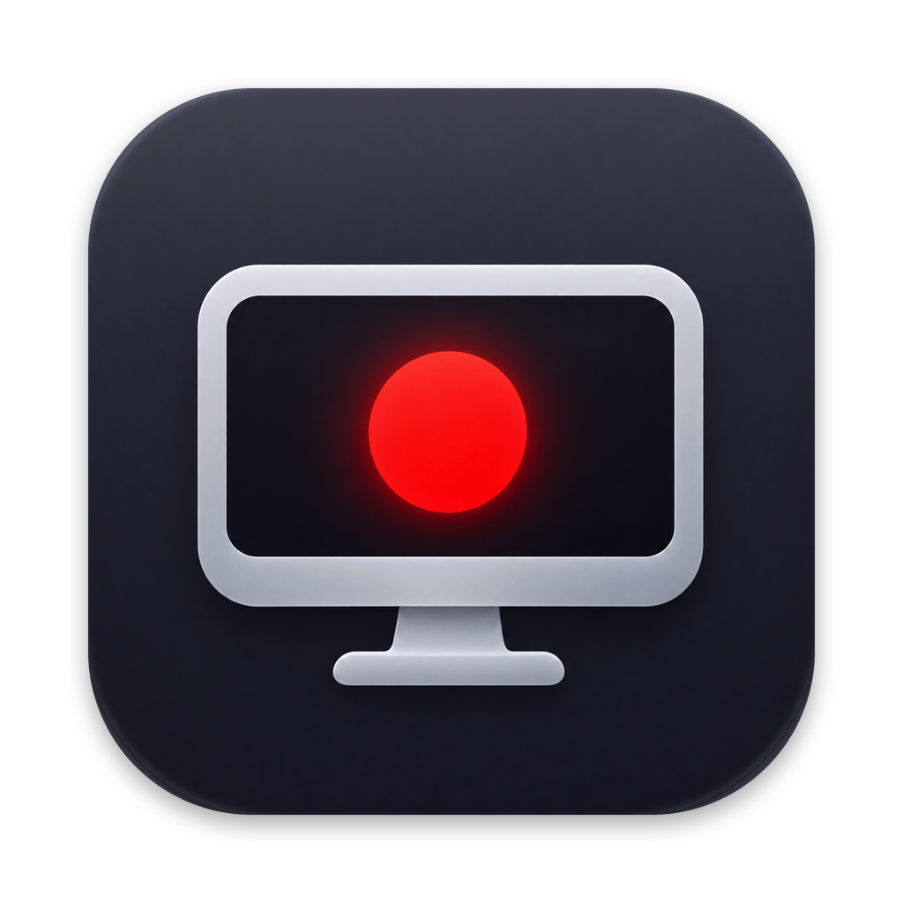

# CaptureDesktop

A screen recorder for macOS that hands its recordings to DaVinci Resolve for editing.

It records the screen, camera, microphone and system audio as separate, synchronised files, then builds a ready-to-edit Resolve project from them. It is a recorder with a small review step, not a video editor.



## Features

- **Sources:** screen (a whole display, one window, or a selected area), camera, microphone and system audio, each with its own switch.
- **Camera choice:** pick which camera to record when more than one is connected. A chosen camera that is unplugged is never silently replaced by another.
- **Editing-friendly files:** constant frame rate HEVC video, 24-bit 48 kHz audio, and every file starting at the same instant so the layers line up on a timeline.
- **Live previews:** screen thumbnail, camera picture (mirrored by default) and audio level waveforms before you record.
- **Cursor effects:** the pointer's movements and clicks are logged during recording and can be rendered afterwards as a transparent highlight layer.
- **Camera cutout:** the camera can be rendered with its background removed, as a rectangle or a circle.
- **DaVinci Resolve handoff:** one button creates a Resolve project with the screen, cursor effects and camera picture-in-picture on separate video tracks, and system audio and microphone on separate audio tracks.
- **Menu bar control:** start and stop from the menu bar, a floating Stop button, or the Dock icon.
- **Global shortcut:** press ⌥⇧⌘R in any app to start recording (after the countdown), cancel the countdown, or stop.

## Download

Get the latest signed and notarized build from the [releases page](https://github.com/djedi/CaptureDesktop/releases/latest): download `CaptureDesktop.zip`, unzip it and move CaptureDesktop to your Applications folder. To build it yourself, see below.

## Requirements

- macOS 15 or later.
- Xcode with Swift 5 language mode support, and [XcodeGen](https://github.com/yonaskolb/XcodeGen) to generate the project.
- For the Resolve handoff only: **DaVinci Resolve Studio** (the free version does not allow external scripting) and a system Python 3. In Resolve, set Preferences > System > General > "External scripting using" to Local.

## Build and run

```sh
xcodegen generate
xcodebuild -project CaptureDesktop.xcodeproj -scheme CaptureDesktop -configuration Debug -derivedDataPath build build
open build/Build/Products/Debug/CaptureDesktop.app
```

Run `xcodegen generate` again whenever source files are added or removed.

### Signing

The default is ad-hoc signing, which works but makes macOS forget the screen, camera and microphone permissions on every rebuild. To keep them, copy `Config/Local.xcconfig.example` to `Config/Local.xcconfig` (gitignored) and set your own signing identity and team ID. List your identities with:

```sh
security find-identity -v -p codesigning
```

### Permissions

On first use macOS asks for Screen Recording, Camera and Microphone access. Screen Recording is granted in System Settings > Privacy & Security, and the app must be relaunched afterwards.

## Using it

1. Choose the sources in the recorder window or the menu bar panel.
2. Press **Start Recording**, or ⌥⇧⌘R from any app. Recording begins after a 3-second countdown.
3. Stop with ⌥⇧⌘R, the floating Stop button, the menu bar panel or the Dock icon.
4. In the review window, adjust the cursor effects and camera layout, then create a Resolve project or export the layers.

### Output

Each recording gets its own folder in `~/Movies/CaptureDesktop/`, named by date and time:

| File | Contents |
| --- | --- |
| `screen.mov` | Screen video with system audio and microphone as separate audio tracks |
| `audio.mov` | The audio tracks, when the screen is not recorded |
| `camera.mov` | Camera video |
| `cursor.jsonl` | Pointer positions and clicks |
| `session.json` | Recording settings and a summary of the session |
| `cursor-effects-<tag>.mov` | Rendered cursor highlight layer (ProRes 4444 with transparency) |
| `camera-cutout-<tag>.mov` | Rendered camera cutout (ProRes 4444 with transparency) |

The rendered layers are large: roughly 95 MB per minute for cursor effects and 600 MB per minute for the camera cutout.

## Command-line options

The app can be driven from the command line for scripted recordings and tests. Launch it with `open -W -n CaptureDesktop.app --args …` so macOS attributes permissions to the app.

| Option | Effect |
| --- | --- |
| `--record-seconds N` | Record for N seconds without the UI, then quit. Uses the camera chosen in the app |
| `--fps N` | Frame rate, 1 to 120 |
| `--output DIR` | Where to put the recording folder |
| `--area X,Y,W,H` | Record an area of the main display, in points |
| `--window-app NAME` | Record the first window of the named app |
| `--no-screen`, `--no-camera`, `--no-mic`, `--no-system-audio` | Leave a source out |
| `--standard-res` | Record at 1x instead of native (Retina) resolution |
| `--show-outline` | Show the outline of the recorded area |
| `--review FOLDER` | Open the review window for an existing recording |
| `--render-cursor FOLDER` | Render the cursor effects layer, then quit |
| `--process-camera FOLDER` | Render the camera cutout, then quit (`--circle`, `--keep-background`) |
| `--resolve-project FOLDER` | Create a Resolve project from a recording, then quit (`--project-name NAME`) |
| `--ui-test-seconds N` | Run the full window flow for N seconds, then quit |

Unknown, repeated or conflicting options exit with status 2.

## Known limits

- The Resolve handoff needs Resolve Studio and a system Python 3.
- Area presets are centred on the screen, and the selected area is not remembered between launches.
- The global shortcut is fixed at ⌥⇧⌘R and cannot be changed; if another app already uses it, it does nothing.
- System audio can start or end with up to about 20 ms of silence.
- Long recordings and multi-display setups have had little testing.

## License

CaptureDesktop is free software: you can redistribute it and/or modify it under the terms of the GNU General Public License as published by the Free Software Foundation, either version 3 of the License, or (at your option) any later version.

It is distributed in the hope that it will be useful, but WITHOUT ANY WARRANTY; without even the implied warranty of MERCHANTABILITY or FITNESS FOR A PARTICULAR PURPOSE. See [LICENSE](LICENSE) for the full text.

DaVinci Resolve is a trademark of Blackmagic Design. This project is not affiliated with or endorsed by Blackmagic Design.
